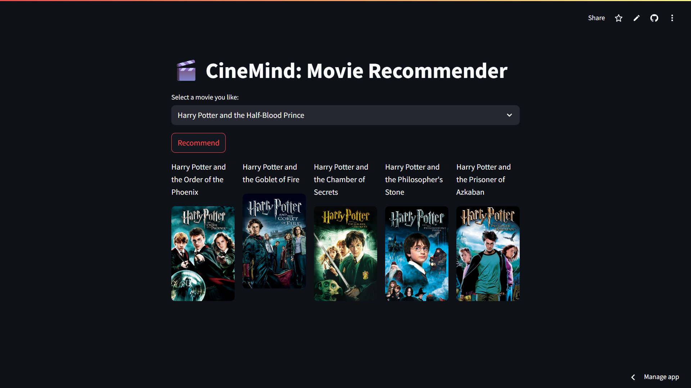
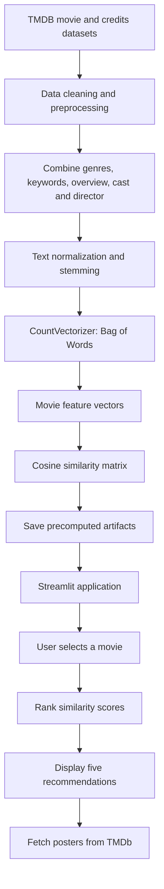

# 🎬 CineMind — Content-Based Movie Recommendation System

<p align="center">
  <strong>Discover your next movie with recommendations based on story, genres, keywords, cast, and crew.</strong>
</p>

<p align="center">
  <a href="https://cinemind.streamlit.app/">🚀 Live Demo</a> ·
  <a href="https://github.com/AdityaGangboir/CineMind">📦 GitHub Repository</a>
</p>

<p align="center">
  
  
  
</p>

---

## 📸 Preview

<p align="center">
  
</p>

> **Try it:** [cinemind.streamlit.app](https://cinemind.streamlit.app/)

## ✨ Overview

**CineMind** is a movie recommendation web app built with Python and Streamlit. Select a movie you enjoy, and CineMind recommends **five similar movies** using a content-based recommendation engine.

Rather than relying on other users' ratings, the recommender compares movie metadata. It combines information such as genres, plot overview, keywords, cast, and director into a text representation, then uses text vectorization and cosine similarity to find movies with similar content.

## 🚀 Features

- **Content-based recommendations** — discover movies with similar metadata and themes.
- **Natural-language preprocessing** — clean and combine selected metadata into a compact movie representation.
- **Bag of Words** — `CountVectorizer` converts movie tags into numeric feature vectors.
- **Cosine similarity** — ranks candidate movies by similarity to the selected title.
- **Top-5 results** — returns the five highest-ranked alternatives, excluding the selected movie itself.
- **Movie posters** — retrieves poster information through the TMDb API.
- **Interactive web interface** — choose a title and get recommendations from a Streamlit app.
- **Precomputed model artifacts** — movie metadata and similarity scores are downloaded on first run instead of being recomputed each time.

## 🧠 How It Works



### Recommendation pipeline

1. **Prepare the metadata:** the development notebook merges the TMDB 5000 Movies and Credits datasets and extracts relevant fields, including genres, keywords, overview, cast, and director.
2. **Create movie tags:** selected fields are cleaned and combined into a single text representation for each movie. The notebook also applies stemming during text preprocessing.
3. **Vectorize the text:** `CountVectorizer` creates Bag-of-Words feature vectors, limited to the 5,000 most frequent features and excluding English stop words.
4. **Compute similarity:** cosine similarity compares each movie vector with every other movie vector. The notebook produces a **4,806 × 4,806** similarity matrix for the processed catalogue.
5. **Recommend:** when a title is selected, the app ranks its similarity scores and displays the five highest-scoring alternatives.
6. **Enrich the results:** the app requests poster paths from TMDb and displays the posters alongside the recommended titles.

## 🛠️ Tech Stack

| Area | Tools |
|---|---|
| Language | Python |
| Data processing | Pandas, NumPy |
| Text processing | NLTK Porter Stemmer, scikit-learn `CountVectorizer` |
| Recommendation algorithm | Cosine similarity |
| Web application | Streamlit |
| HTTP requests | Requests |
| Model/artifact loading | Pickle |
| Artifact download | gdown / Google Drive |
| Movie metadata and posters | TMDB datasets and API |

## ⚙️ Getting Started

### Prerequisites

- Python 3.10 or later recommended
- Git
- An internet connection on the first app launch to download the precomputed files and retrieve poster information

### 1. Clone the repository

```bash
git clone https://github.com/AdityaGangboir/CineMind.git
cd CineMind
```

### 2. Create and activate a virtual environment

**Windows PowerShell**

```powershell
py -m venv .venv
.\.venv\Scripts\Activate.ps1
```

**macOS / Linux**

```bash
python3 -m venv .venv
source .venv/bin/activate
```

### 3. Install dependencies

```bash
python -m pip install --upgrade pip
pip install -r requirements.txt gdown
```

> `gdown` is imported by `app.py` to download the precomputed `.pkl` files. It is not currently listed in `requirements.txt`, so it is installed explicitly above. For a cleaner setup, add `gdown` to `requirements.txt` and then use `pip install -r requirements.txt` alone.

### 4. Launch CineMind

```bash
streamlit run app.py
```

Streamlit will print a local URL—usually `http://localhost:8501`. Open it in your browser, select a movie, and click **Recommend**.

### First-run behavior

If `movies_dict.pkl` and `similarity.pkl` are not present locally, `app.py` attempts to download them from Google Drive and saves them in the project directory. The Google Drive files must remain accessible for this step to succeed.

## 🗂️ Project Structure

```text
CineMind/
├── app.py                 # Streamlit app and recommendation logic
├── MRS.ipynb              # Data preparation, feature engineering and model notebook
├── requirements.txt       # Python dependencies
├── public/
│   └── image.png           # README preview image
├── movies_dict.pkl        # Downloaded at runtime; movie metadata artifact
└── similarity.pkl         # Downloaded at runtime; cosine similarity matrix
```

> The two `.pkl` files are fetched at runtime and may not be committed to the repository. The notebook expects the source CSV files to be available locally when reproducing the preprocessing and model-building steps.

## 📚 Dataset

The development notebook uses the **TMDB 5000 Movie Dataset**, with two source files:

- `tmdb_5000_movies.csv`
- `tmdb_5000_credits.csv`

A commonly used source is the [TMDB 5000 Movie Dataset on Kaggle](https://www.kaggle.com/datasets/tmdb/tmdb-movie-metadata). Download the files and place them where `MRS.ipynb` expects them before running the notebook from the beginning.

The deployed app uses precomputed artifacts, so the CSV files are not needed just to launch the app when the Google Drive artifacts are accessible.

## 🔑 API Key and Security Notes

The application calls the TMDb API to retrieve movie poster information. **The current version of `app.py` contains an API key directly in the source code.** Before sharing or deploying the repository, rotate that key and update the application to load the replacement from an environment variable or Streamlit secrets. Never commit API keys or other credentials to GitHub.

The app also loads serialized Python objects with `pickle`. Only load pickle files from a source you trust; untrusted pickle files can execute arbitrary code during deserialization.

## ⚠️ Scope and Limitations

- This is a **content-based** recommender; it does not learn from an individual user's watch history or ratings.
- Recommendations depend on the quality and coverage of the available metadata and the precomputed similarity matrix.
- Similarity indicates overlap in the selected text features, not a guarantee that a user will enjoy a recommended movie.
- Poster retrieval depends on network connectivity and TMDb API availability.
- The current interface returns five recommendations for a selected catalogue title; it is not a search engine over every movie ever released.

## 🧭 Possible Improvements

- Move the TMDb API key to Streamlit secrets or environment variables.
- Add caching and robust error handling for poster requests.
- Display genres, release years, ratings, and short explanations for each recommendation.
- Add filters for genre, language, release year, and rating.
- Evaluate recommendation quality with a documented offline evaluation strategy and representative test cases.
- Add automated tests for missing titles, missing posters, and unavailable model artifacts.

## 🙌 Acknowledgements

- [TMDB](https://www.themoviedb.org/) for movie metadata and poster information.
- [Streamlit](https://streamlit.io/) for the interactive application framework.
- The maintainers of Pandas, NumPy, NLTK, and scikit-learn for the data and machine-learning tools used in this project.

---

<p align="center">
  Made with 🎬 and Python · <a href="https://github.com/AdityaGangboir">Aditya Gangboir</a>
</p>
